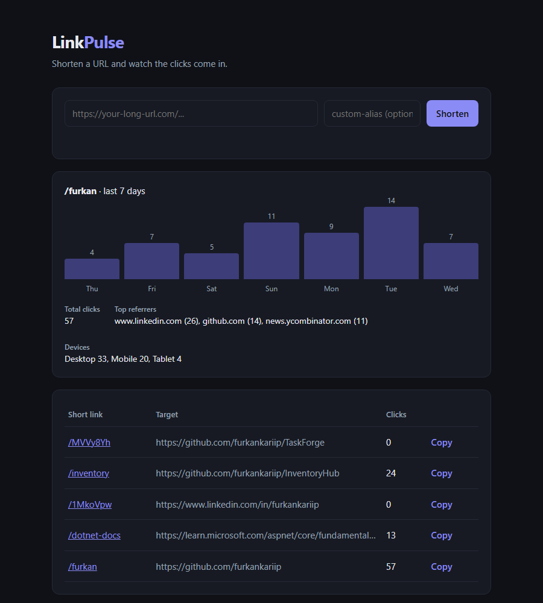

# LinkPulse

[](https://github.com/furkankariip/LinkPulse/actions/workflows/ci.yml)


A URL shortener with real-time click analytics, built with **ASP.NET Core 9 Minimal APIs**.
Small enough to read in one sitting, but it covers the patterns I use in production
code: background processing, caching, rate limiting, consistent error responses and
integration tests that boot the real app.



## Features

- **Short links**: random Base62 codes (cryptographically secure) or custom aliases, with optional expiry
- **Click analytics**: clicks per day, top referrers and device breakdown for every link
- **Fast redirects**: lookups are cached in memory, and clicks are written by a background worker instead of during the redirect
- **Rate limiting**: link creation is limited per client IP with a fixed-window policy (`429` with `Retry-After`)
- **RFC 9457 Problem Details** for every error (validation, 404, 409, 410, 429, 500)
- **OpenAPI document + Scalar UI** for interactive API docs
- **Health check** that also checks the database
- **Docker image** (non-root user, persistent volume) and **GitHub Actions CI** with a container smoke test

## How a redirect works

```
GET /{code}
   │
   ├─► IMemoryCache ──miss──► SQLite (EF Core)        lookup: cached for 10 minutes
   │
   ├─► expired?  ──► 410 Gone (Problem Details)
   │
   ├─► ClickQueue.TryEnqueue(click)                    non-blocking, bounded Channel<T>
   │         │
   │         └──► ClickRecorder (BackgroundService) ──► batch insert, up to 100 clicks
   │
   └─► 302 Found → target URL
```

The redirect never waits on an analytics write. `ClickRecorder` drains the channel in batches,
and skips clicks for links that were deleted in the meantime. A `302` is used on purpose:
browsers cache a `301`, so repeat visits would never reach the server and would not be counted.

## API

| Method   | Route                     | Description                                    |
|----------|---------------------------|------------------------------------------------|
| `POST`   | `/api/links`              | Create a short link (rate limited)             |
| `GET`    | `/api/links?page&pageSize`| List links, newest first                       |
| `GET`    | `/api/links/{code}`       | Link details including total clicks            |
| `GET`    | `/api/links/{code}/stats` | Last 7 days, top referrers, device breakdown   |
| `DELETE` | `/api/links/{code}`       | Delete a link and its click history            |
| `GET`    | `/{code}`                 | Redirect to the target and record the click    |
| `GET`    | `/health`                 | Health check (includes the database)           |

```http
POST /api/links
Content-Type: application/json

{ "url": "https://github.com/furkankariip", "alias": "furkan", "expiresAt": "2026-12-31T23:59:59Z" }
```

```json
{
  "code": "furkan",
  "shortUrl": "http://localhost:5291/furkan",
  "targetUrl": "https://github.com/furkankariip",
  "createdAt": "2026-10-28T07:38:21.98Z",
  "expiresAt": "2026-12-31T23:59:59Z",
  "totalClicks": 0
}
```

Interactive docs are served at `/scalar`, and the OpenAPI document at `/openapi/v1.json`.

## Getting started

**Requirements:** .NET 9 SDK. No database server is needed: SQLite is created on first run.

```bash
git clone https://github.com/furkankariip/LinkPulse.git
cd LinkPulse
dotnet run --project src/LinkPulse.Api
# open http://localhost:5291
```

**With Docker**

```bash
docker build -t linkpulse .
docker run -p 8080:8080 -v linkpulse-data:/data linkpulse
# open http://localhost:8080
```

**Tests**

```bash
dotnet test
```

## Testing approach

- **Integration tests** use `WebApplicationFactory` to run the whole pipeline (routing, validation,
  rate limiter, background worker, EF Core) against a throwaway SQLite file per test class.
- Time is injected through `TimeProvider`, so expiry is tested by moving a `FakeTimeProvider` forward
  instead of sleeping.
- **Unit tests** cover the code generator, user-agent classification and request validation.

## Project structure

```
src/LinkPulse.Api
├── Domain/            ShortLink, LinkClick entities
├── Data/              AppDbContext (UTC conversion, indexes, cascade delete)
├── Features/Links/    endpoints, contracts, validation, LinkService
├── Infrastructure/    click queue + recorder, rate limiting, exception handler, helpers
└── wwwroot/           small dependency-free dashboard
tests/LinkPulse.Tests  integration and unit tests (xUnit)
```

## Tech stack

ASP.NET Core 9 · Minimal APIs · EF Core 9 (SQLite) · System.Threading.Channels ·
Rate Limiting middleware · OpenAPI + Scalar · xUnit · WebApplicationFactory · Docker · GitHub Actions

## Possible next steps

- Swap SQLite for PostgreSQL and use EF Core migrations
- API keys so each user only sees their own links
- Distributed cache (Redis) and a distributed rate limiter for running more than one instance
- QR code generation per link

## License

[MIT](LICENSE)
